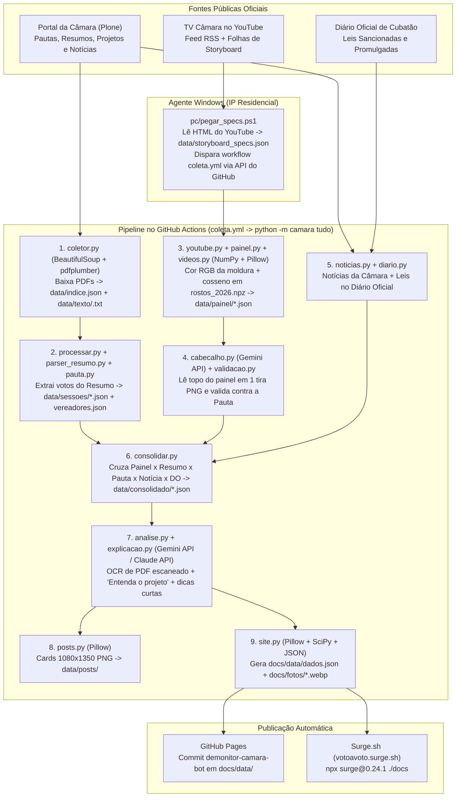

# Voto a Voto — Monitor da Câmara Municipal de Cubatão

Plataforma cívica e independente de transparência legislativa que coleta automaticamente tudo o que a **Câmara Municipal de Cubatão/SP** publica — pautas, resumos oficiais de sessão, projetos de lei, vetos, notícias, Diário Oficial do Município e transmissões da TV Câmara no YouTube — e transforma em **dados abertos auditáveis**, **análises imparciais baseadas estritamente no documento oficial** e um **portal web interativo**.

- **Portal principal (Surge):** [https://votoavoto.surge.sh](https://votoavoto.surge.sh)
- **Espelho oficial (GitHub Pages):** [https://wardernoob-dot.github.io/monitor-camara-cubatao/](https://wardernoob-dot.github.io/monitor-camara-cubatao/)

---

## Sumário

1. [Visão Geral e Status](#1-visão-geral-e-status)
2. [Dando Nome aos Bois: Quem Faz o Quê no Sistema](#2-dando-nome-aos-bois-quem-faz-o-quê-no-sistema)
3. [O Papel Exato do GitHub Actions (Os 5 Workflows e seus Jobs)](#3-o-papel-exato-do-github-actions-os-5-workflows-e-seus-jobs)
4. [O Papel Exato da Gemini API e da Claude API em Cada Parte](#4-o-papel-exato-da-gemini-api-e-da-claude-api-em-cada-parte)
5. [Fontes Oficiais e Cruzamento de Dados](#5-fontes-oficiais-e-cruzamento-de-dados)
6. [Regras de Interpretação Legislativa](#6-regras-de-interpretação-legislativa)
7. [Anomalias Reais dos Documentos Tratadas pelo Código](#7-anomalias-reais-dos-documentos-tratadas-pelo-código)
8. [Engenharia de Segurança e Hardening (AppSec & CI/CD)](#8-engenharia-de-segurança-e-hardening-appsec--cicd)
9. [Estrutura do Repositório](#9-estrutura-do-repositório)
10. [Como Rodar Localmente](#10-como-rodar-localmente)
11. [Princípios Inegociáveis do Projeto](#11-princípios-inegociáveis-do-projeto)

---

## 1. Visão Geral e Status

| Módulo / Etapa | Responsável Técnico | Estado Atual | O que entrega |
|---|---|---|---|
| **Coletor Documental** | `camara/coletor.py` (`requests` + `BeautifulSoup` + `pdfplumber`) | Em produção (a cada 4h) | Varre pautas, resumos e projetos no portal Plone da Câmara, calcula `SHA-256` em `data/indice.json` e extrai o texto integral em `data/texto/<sha256>.txt`. |
| **Agente Residencial de Storyboard** | `pc/pegar_specs.ps1` (PowerShell no Windows) | Em produção (a cada 4h) | Roda em IP residencial para contornar o bloqueio de IPs de nuvem do YouTube, extrai o `spec` de storyboard das sessões novas e grava em `data/storyboard_specs.json`. |
| **Leitura do Painel Eletrônico** | `camara/youtube.py` + `camara/painel.py` + `camara/videos.py` (`Pillow` + `NumPy`) | Em produção (desde set/2026) | Baixa as folhas de miniaturas do YouTube (`i.ytimg.com`), reconhece o rosto de cada vereador por similaridade de cosseno (`data/rostos_2026.npz`) e lê o voto pela cor RGB da moldura (**100% determinístico, sem IA**). |
| **Leitura do Cabeçalho e Validação** | `camara/cabecalho.py` (**Gemini Vision API**) + `camara/validacao.py` | Em produção | Transcreve o texto minúsculo (~5 px) no topo do painel via Gemini e **confere obrigatoriamente contra a Pauta Oficial do dia** (`camara/pauta.py`). |
| **Parser de Resumos e Pautas** | `camara/processar.py` + `camara/parser_resumo.py` + `camara/pauta.py` | Em produção | Limpa anomalias tipográficas dos PDFs, normaliza nomes/suplentes (`camara/nomes.py`) e gera `data/sessoes/*.json` e `data/vereadores.json`. |
| **Notícias e Diário Oficial** | `camara/noticias.py` + `camara/diario.py` | Em produção | Raspa notícias das sessões (`data/noticias/*.json`) e consulta o Diário Oficial do Município dos últimos 45 dias (`data/diario.json`) para descobrir leis sancionadas/promulgadas. |
| **Consolidador Multi-Fonte** | `camara/consolidar.py` | Em produção | Cruza **Painel × Resumo Oficial × Pauta × Notícia × Diário Oficial** em `data/consolidado/<AAAA-MM-DD>.json`, mantendo divergências lado a lado. |
| **Análise Imparcial e Explicações** | `camara/analise.py` + `camara/explicacao.py` (**Gemini API** / **Claude API**) | Em produção | Faz OCR de PDFs escaneados, gera a seção *"Entenda o projeto"* com trava anti-alucinação (`data/analises/*.json`) e reescreve ementas em linguagem simples (`data/explicacoes.json`). |
| **Exportador do Site e Cards** | `camara/site.py` + `camara/posts.py` + `frontend/` (React/TypeScript/Vite) | Em produção | Recorta fotos dos vereadores (`docs/fotos/*.webp`), exporta `docs/data/dados.json`, compila o portal estático em `docs/` e gera cards PNG (`data/posts/`). |

---

## 2. Dando Nome aos Bois: Quem Faz o Quê no Sistema

Todo o fluxo é orquestrado pelo comando `python -m camara tudo` (definido em [`camara/__main__.py`](camara/__main__.py)), que encadeia os módulos exatamente nesta ordem:



### Detalhamento passo a passo do Pipeline (`camara/__main__.py`)

1. **`Coletor.coletar()` (`camara/coletor.py`):**
   - Usa `requests.Session` (com intervalo mínimo de `1.5s` entre requisições) e `BeautifulSoup` para varrer recursivamente até 3 níveis nas seções `/processo-legislativo/resumo-das-sessoes`, `/pauta-das-sessoes-1` e `/projetos-de-lei`.
   - Converte links Plone `/view` em `/at_download/file`, baixa o binário PDF (máximo `25 MB`), calcula o `SHA-256` e usa `pdfplumber` para extrair o texto de até `250` páginas por documento.
   - Se o documento tiver menos de `80` caracteres por página, marca `"precisa_ocr": true` em `data/indice.json`.
2. **`processar()` (`camara/processar.py` + `camara/parser_resumo.py` + `camara/pauta.py`):**
   - Passa o texto bruto por `camara/textclean.py` (que desfaz letras/palavras/linhas duplicadas de "negrito falso" e troca caracteres cirílicos por latinos).
   - Extrai do Resumo Oficial a lista de presença, cada item votado, o tipo de votação (nominal ou simbólica), os votos individuais e o resultado, normalizando cada nome de parlamentar pelo catálogo canônico de `camara/nomes.py`.
   - Salva cada sessão em `data/sessoes/AAAA-MM-DD_<tipo>_<numero>.json` e atualiza o cadastro e estatísticas de presença em `data/vereadores.json`.
3. **`processar_videos()` + `limpar_falsos()` (`camara/videos.py` + `camara/painel.py` + `camara/youtube.py`):**
   - Lê as especificações salvas em `data/storyboard_specs.json` (alimentadas pelo PC residencial) ou busca no YouTube.
   - `youtube.py:baixar_urls()` baixa as folhas JPEG de storyboard (`L3_M000.jpg`, `L3_M001.jpg`..., grade `5×5` de miniaturas `320×180` a cada ~2 segundos de vídeo) direto de `https://i.ytimg.com/sb/...`.
   - `painel.py:eh_painel()` analisa cada miniatura verificando se o fundo escuro, o cabeçalho e a grade `3×5` de cartões de vereadores estão presentes na tela.
   - `painel.py:ler_quadro()` recorta as 15 posições da grade:
     - **Quem está em cada posição:** compara o recorte do rosto (`20×20` RGB normalizado) por produto escalar/similaridade de cosseno contra os vetores de referência em `data/rostos_2026.npz` (`Rostos.identificar`).
     - **Qual foi o voto:** mede a cor média RGB das bordas da moldura do cartão (`_estado_celula`):
       - **Verde** (`G - R > 25` e `G - B > 15`): voto `favor`
       - **Vermelho** (`R - G > 30` e `R - B > 20`): voto `contra`
       - **Branco brilhante**: `presente_sem_voto`
       - **Escuro/apagado**: `ausente`
   - `painel.py:segmentar_votacoes()` agrupa os quadros contínuos de cada votação, escolhe o quadro estabilizado final e salva as miniaturas em `data/painel/img/<video_id>/<seg>.jpg` e os votos brutos em `data/painel/<video_id>.json`.
4. **`identificar_pendentes()` + `validar_todas()` (`camara/cabecalho.py` + `camara/validacao.py`):**
   - Recorta a faixa superior (`miniatura[14:46, 10:310]`) de cada votação, envia uma única tira PNG ampliada para a **API do Gemini** transcrever o texto e extrai tipo, número, ano, turno e parecer por regex.
   - `validacao.py:validar_sessao()` cruza o que foi lido no cabeçalho do vídeo com a **Pauta Oficial** daquele mesmo dia (`data/pautas/`), corrigindo eventuais dígitos borrados na miniatura ou marcando se o item entrou como urgência/extra-pauta.
5. **`coletar_noticias()` + `coletar_diario()` (`camara/noticias.py` + `camara/diario.py`):**
   - `noticias.py` lê o feed RSS de notícias da Câmara (`cubatao.sp.leg.br/assuntos/ultimas-noticias/RSS`), baixa o HTML das notícias sobre sessões e extrai menções a projetos e placares (`data/noticias/<slug>.json`).
   - `diario.py` consulta a API/páginas do Diário Oficial de Cubatão dos últimos 45 dias procurando sanções e promulgações (`LEI Nº X.XXX`) que correspondam aos projetos aprovados (`data/diario.json`).
6. **`consolidar_tudo()` (`camara/consolidar.py`):**
   - Une em um único arquivo por dia (`data/consolidado/AAAA-MM-DD.json`) os dados das 5 fontes: **Painel do YouTube**, **Resumo Oficial**, **Pauta**, **Notícia** e **Diário Oficial**.
   - Quando uma votação tem registro tanto no Painel quanto no Resumo Oficial, preserva ambos e aponta explicitamente qualquer divergência por vereador.
7. **`analisar_tudo()` (`camara/analise.py`):**
   - Faz o OCR via **Gemini API** de PDFs de projetos escaneados pendentes e gera a análise estruturada *"Entenda o projeto"* (`data/analises/<TIPO>-<NNN>-<ANO>.json`).
8. **`gerar_posts()` (`camara/posts.py`):**
   - Usa `Pillow` para desenhar os cards visuais (`1080×1350 px`) de capa, resumo e grade nominal de votos de cada projeto para o Instagram (`data/posts/`).
9. **`gerar_site()` (`camara/site.py`):**
   - Chama `camara/explicacao.py` (que usa a **Gemini API** em lotes de 20 para gerar explicações curtas em `data/explicacoes.json`).
   - Processa as fotos da pasta `fotos/` (`preparar_fotos()`): casa o nome do arquivo com o apelido/nome civil do vereador, localiza o rosto usando `scipy.ndimage` + `Pillow`, recorta quadrado em `480×480 px` e converte para WebP em `docs/fotos/<slug>.webp`.
   - Exporta `docs/data/dados.json`, `docs/data/analises/*.json` e `docs/explicacoes.json`, que alimentam a aplicação React compilada em `docs/`.

---

## 3. O Papel Exato do GitHub Actions (Os 5 Workflows e seus Jobs)

Toda a automação de nuvem mora em [`.github/workflows/`](.github/workflows/). Veja exatamente o que cada workflow e cada job faz:

### 3.1. `coleta.yml` — Workflow `coleta-diaria` (O Motor Principal)
- **Quando roda:** Automaticamente a cada **4 horas** no minuto 17 (`cron: "17 */4 * * *"`) ou sob demanda (`workflow_dispatch`, acionado manualmente ou pelo script `pc/pegar_specs.ps1` quando sai vídeo novo).
- **Job `coletar` (`ubuntu-latest`, timeout de 30 min):**
  1. **Setup seguro:** Faz checkout do código (`actions/checkout` fixado por SHA) e configura Python 3.12 (`actions/setup-python` fixado por SHA), instalando pacotes com `pip install --only-binary=:all: -r requirements.txt`.
  2. **Portão de Testes (`pytest`):** Executa `python -m pytest -q`. Se qualquer um dos **53 testes** falhar, o job para imediatamente antes de fazer qualquer requisição ou alterar dados.
  3. **Execução do Pipeline:** Roda `python -m camara tudo --desde "$DESDE"` com o secret `GEMINI_API_KEY` injetado via variável de ambiente.
  4. **Commit Automático (`monitor-camara-bot`):** Verifica se houve alteração em `data/` (`git diff --cached --quiet`). Se houver novidade, adiciona também `docs/data/` (mantendo o **GitHub Pages** atualizado), cria o commit `"dados: coleta AAAA-MM-DD"` e faz `git push` na branch `main`.
  5. **Deploy no Surge:** Se os secrets `SURGE_LOGIN` e `SURGE_TOKEN` estiverem presentes, executa `npx --yes surge@0.24.1 ./docs votoavoto.surge.sh` (com `continue-on-error: true` para que uma instabilidade externa no Surge nunca derrube a coleta de dados).

### 3.2. `publicar-surge.yml` — Workflow `publicar-surge` (Sincronizador do Site e Fotos)
- **Quando roda:** Automaticamente em qualquer `push` na `main` que modifique arquivos em `docs/**`, `fotos/**` ou `camara/site.py` (ou via `workflow_dispatch`).
- **Job `publicar` (`ubuntu-latest`, timeout de 15 min):**
  1. Executa `camara.site.exportar(Path('data'))` **offline** (sem raspar a Câmara novamente), regenerando `docs/data/dados.json` e reprocessando eventuais fotos novas de vereadores em `fotos/` para `docs/fotos/*.webp`.
  2. Se `docs/data/` ou `docs/fotos/` mudaram, commita e dá `git push` na `main` (`"site: regenera docs/data e docs/fotos"`) para que o **GitHub Pages** receba os arquivos atualizados.
  3. Publica `./docs` em `https://votoavoto.surge.sh` via `npx --yes surge@0.24.1`.

### 3.3. `claude-rotinas.yml` — Workflow `claude-rotinas` (Auditoria, Auto-Diagnóstico e Manutenção)
Utiliza a action oficial `anthropics/claude-code-action` autenticada com o secret `ANTHROPIC_API_KEY`. Nunca altera arquivos históricos em `data/`; atua apenas abrindo **Issues** ou **Pull Requests** para revisão humana. Possui **3 jobs distintos**:

1. **Job `conferir-coleta` (Auditoria Diária):**
   - **Quando roda:** Todos os dias às `21:30 UTC` (`18:30` de Brasília, logo após a coleta noturna) ou via `workflow_dispatch`.
   - **O que faz:** Executa o script `.claude/skills/conferir-coleta-do-dia/resumo.py` e segue o roteiro `SKILL.md` sobre as coletas das últimas 24h. Se encontrar avisos do parser, PDF escaneado sem OCR, votação do painel não identificada ou divergência incomum entre painel e resumo, abre (ou comenta em) uma Issue intitulada `"conferir coleta AAAA-MM-DD"`. Se estiver tudo limpo, encerra em silêncio.
2. **Job `diagnosticar-falha` (Auto-Recuperação de Quebras):**
   - **Quando roda:** Automaticamente (`workflow_run`) sempre que o workflow `coleta-diaria` terminar com status `failure`.
   - **O que faz:** Baixa o log da falha (`gh run view --log-failed`) sob regras estritas contra *Prompt Injection*.
     - Se a falha foi causada por **mudança no PDF/HTML da Câmara** (nova grafia de vereador, variante nova de negrito falso, layout novo): reproduz o erro com `pytest`, corrige o código em `camara/`, adiciona teste unitário e abre um **Pull Request** na branch `fix/coleta-AAAA-MM-DD`.
     - Se a falha foi **infraestrutura externa** (portal da Câmara fora do ar, timeout de rede, bloqueio do YouTube): não toca no código e abre uma **Issue** relatando o incidente.
3. **Job `manutencao` (Atualização Semanal):**
   - **Quando roda:** Toda segunda-feira às `11:00 UTC` (`08:00` de Brasília) ou via `workflow_dispatch`.
   - **O que faz:** Inspeciona `pip list --outdated` e `npm outdated`, aplica atualizações *minor/patch* seguras (com `--only-binary=:all:` e `--ignore-scripts`), roda `python -m pytest -q` e `npm run build`, verifica se a documentação (`README.md`, `CLAUDE.md`, `fotos/LEIA-ME.md`) continua fiel ao código e abre um **Pull Request** na branch `manutencao/AAAA-MM-DD`.

### 3.4. `claude.yml` — Workflow `claude` (Assistente `@claude` e Revisor Regimental de PRs)
Também baseado em `anthropics/claude-code-action` + `ANTHROPIC_API_KEY`, dividido em **2 jobs**:

1. **Job `responder`:**
   - **Quando roda:** Quando um comentário ou issue contém `@claude`, **exclusivamente se o autor do evento for o dono do repositório (`github.actor == 'wardernoob-dot'`)**.
   - **O que faz:** Atende pedidos de manutenção (ex.: cadastrar foto nova, ajustar regra de parser, melhorar texto de interface) abrindo uma branch e um Pull Request.
2. **Job `revisar`:**
   - **Quando roda:** Automaticamente sempre que um Pull Request é aberto ou atualizado tocando em arquivos críticos de voto ou interface (`camara/parser_resumo.py`, `camara/consolidar.py`, `camara/site.py`, `camara/posts.py`, `camara/painel.py`, `prompts/analise.md`, `frontend/src/**`).
   - **O que faz:** Revisa o `git diff` contra as **Regras de Interpretação de Voto** (verificando se "não consta" não virou voto contrário, se parecer contrário e veto mantêm a semântica correta, se `docs/` foi recompilado e se `docs/CNAME` não foi incluído) e comenta no PR apenas se encontrar problemas reais.

### 3.5. `sonda-storyboard.yml` — Workflow `sonda-storyboard` (Laboratório de Conectividade)
- **Quando roda:** Apenas manualmente (`workflow_dispatch`).
- **Job `sonda`:** Executa `scripts/sonda_storyboard.py` para testar se os IPs do GitHub Actions conseguem baixar storyboards de IDs de vídeo específicos do YouTube e força o push do resultado exclusivamente na branch isolada `amostras` (sem nunca sujar a `main`).

---

## 4. O Papel Exato da Gemini API e da Claude API em Cada Parte

> **Regra de Ouro:** A Inteligência Artificial **JAMAIS** lê, infere ou decide o voto de um vereador. Os votos vêm 100% da cor RGB dos pixels na moldura do painel (`camara/painel.py`) ou do texto do Resumo Oficial (`camara/parser_resumo.py`).

A API do **Google Gemini** (`https://generativelanguage.googleapis.com/v1beta`, autenticada via header HTTP `x-goog-api-key` com o secret `GEMINI_API_KEY`) e, opcionalmente, a API da **Anthropic Claude** (`https://api.anthropic.com/v1/messages`, via `ANTHROPIC_API_KEY`) entram exatamente em **4 pontos do código**:

### 4.0. Como o código escolhe o modelo Gemini (`camara/cabecalho.py:_modelos_gemini`)
Para nunca quebrar quando o Google descontinua a versão de um modelo, a função `_modelos_gemini()` consulta `GET /v1beta/models`, filtra apenas modelos estáveis que suportam `generateContent` (descartando modelos `preview`, `exp`, `pro`, `image`, `tts`, `audio`, `embedding`) e ordena da versão mais recente para a mais antiga priorizando:
1. Variável `MODELO_GEMINI` (se definida manualmente no ambiente);
2. Família **`gemini-*-flash-lite`** (mais rápida e com maior cota gratuita);
3. Família **`gemini-*-flash`**.

Se o primeiro modelo da fila retornar erro ou limite de cota (`HTTP 429/503`), o código faz *fallback* automático para o próximo modelo da lista.

---

### 4.1. Ponto 1: Leitura do Cabeçalho do Painel de Votação (`camara/cabecalho.py`)
- **Quem chama:** `camara/videos.py:identificar_pendentes()` → `camara/cabecalho.py:identificar()` → `transcrever()`.
- **Qual é o problema técnico:** Nas folhas de storyboard do YouTube (`320×180 px`), a faixa superior do painel eletrônico onde aparece escrito `"Em votação: PL nº 92/2026 - 1ª Discussão"` tem apenas `32×300 px` (letras com ~5 pixels de altura). Motores de OCR convencionais falham nessa resolução, mas modelos multimodais de visão conseguem ler.
- **Como o código otimiza (1 chamada por sessão):**
  1. `corte_cabecalho()` recorta a região `miniatura[14:46, 10:310]` do quadro representativo de cada votação da sessão.
  2. `tira()` redimensiona cada faixa em **`3x`** com filtro `Image.LANCZOS`, desenha um rótulo vermelho (`FAIXA 1`, `FAIXA 2`, ..., `FAIXA N`) e empilha todas verticalmente em um **único arquivo PNG em memória**.
  3. `transcrever()` envia esse PNG em Base64 para `POST /v1beta/models/{modelo}:generateContent` com `temperature: 0` e `response_mime_type: "application/json"`, instruindo o Gemini a transcrever letra por letra (ou escrever `[?]` se ilegível) os campos `situacao` (`APROVADO`/`REJEITADO`), `sessao` e `em_votacao` de cada faixa.
  4. Se alguma faixa voltar com `em_votacao` vazio na chamada em lote, `identificar()` aguarda `4s` e faz uma **2ª chamada individual** com aquela faixa ampliada em **`5x`**.
- **Conferência determinística pós-Gemini:**
  - `interpretar()` usa expressões regulares (`RE_TIPO`, `RE_NUM`, `RE_TURNO`, `RE_PARECER`, `RE_REF`, `RE_AUTOR`) para estruturar o texto transcrito.
  - Em seguida, `camara/validacao.py:validar_sessao()` cruza o número lido pelo Gemini contra os itens da **Pauta Oficial do dia** (`camara/pauta.py`). Um número de projeto só é validado se bater com a pauta oficial ou seguir as regras formais de matéria extra-pauta.

---

### 4.2. Ponto 2: OCR Integral de Projetos em PDF Escaneado (`camara/analise.py:transcrever_pdf`)
- **Quem chama:** `camara/analise.py:analisar_tudo()` → `transcrever_pdf()`.
- **Qual é o problema técnico:** Alguns projetos de lei antigos ou enviados pelo Executivo são publicados no site da Câmara como **PDF de imagem escaneada** (sem texto selecionável, detectados por `coletor.py` quando têm `< 80` caracteres por página).
- **O que a Gemini API faz:**
  1. `transcrever_pdf()` verifica se já existe `data/texto/<sha256>.ocr.txt`. Se existir, não chama a API novamente.
  2. Caso não exista, baixa o PDF original de `https://www.cubatao.sp.leg.br/...` (validando domínio, bloqueando redirects externos e limitando a `15 MB`).
  3. Envia o binário `application/pdf` em Base64 para `POST /v1beta/models/{modelo}:generateContent` com `temperature: 0` e o prompt estrito:
     > *"Transcreva literalmente todo o texto deste documento oficial, na ordem, sem resumir, sem corrigir e sem comentar. Ignore carimbos e assinaturas. Responda só com o texto."*
  4. Se a transcrição retornar mais de `300` caracteres, grava o resultado em `data/texto/<sha256>.ocr.txt` (até `10` PDFs novos por rodada de coleta).

---

### 4.3. Ponto 3: Análise Imparcial *"Entenda o projeto"* (`camara/analise.py`)
- **Quem chama:** `camara/analise.py:analisar_tudo()` → `gerar()` → `_claude()` ou `_gemini()` → `conferir()`.
- **Quem responde (Ordem de Prioridade):**
  1. Se `ANTHROPIC_API_KEY` estiver configurada no ambiente: chama `_claude()` (`POST https://api.anthropic.com/v1/messages`, modelo padrão `claude-haiku-5-5`, `temperature: 0.2`).
  2. Caso contrário (padrão no GitHub Actions `coleta.yml`): chama `_gemini()` (`POST /v1beta/models/{modelo}:generateContent`, `temperature: 0.2`, `response_mime_type: "application/json"`).
- **Quais matérias são analisadas:** Projetos votados dos tipos `PL`, `PLC`, `PR`, `PDL`, `PELOM` e `VETO` que possuam **texto integral disponível** (`data/texto/<sha256>.txt` ou `.ocr.txt`). Projetos que só possuem a ementa curta da pauta **não** são analisados para evitar que o modelo tenha que adivinhar o conteúdo.
- **Isolamento contra viés político:** O bloco `<documento_oficial>` enviado ao modelo contém **apenas** o tipo/número, autoria, ementa e os primeiros `14.000` caracteres do texto oficial do projeto, combinados com o prompt público [`prompts/analise.md`](prompts/analise.md). **Nenhum voto, placar ou nome de vereador que votou é enviado ao modelo.**
- **Trava Anti-Alucinação Determinística (`conferir()`):**
  - O modelo devolve um JSON com `resumo`, `o_que_muda` (até 4 itens), `quem_e_afetado`, `justificativa_do_autor`, `natureza`, `limitacoes` e `pontos_de_atencao` (cada um com `ponto` e `trecho`).
  - A função `conferir()` normaliza o texto oficial do documento (`_n()`) e verifica cada `trecho` citado pelo modelo:
    - O trecho normalizado precisa ter **no mínimo 12 caracteres** (`len(tn) >= 12`, impedindo bypass com uma única palavra curta como `"de"` ou `"lei"`) **e** precisa ser **substring exata** do texto oficial do documento (`tn in base`).
    - Se o modelo inventar, parafrasear ou errar uma palavra da citação, o ponto é **automaticamente removido** de `pontos_de_atencao` e movido para `pontos_descartados` (que fica salvo no JSON para auditoria).
- **Cache inteligente:** O resultado é salvo em `data/analises/<TIPO>-<NNN>-<ANO>.json` junto com `hash_documento` (SHA-256 do texto) e `versao_prompt` (SHA-256 de `prompts/analise.md`). A API só é chamada novamente se o documento ou o prompt mudarem.

---

### 4.4. Ponto 4: Explicações Curtas em Linguagem Simples (`camara/explicacao.py`)
- **Quem chama:** `camara/site.py:exportar()` → `camara/explicacao.py:gerar()` → `_gemini()`.
- **Qual é o objetivo:** Quando o morador passa o mouse (ou toca no botão `"i"`) sobre uma proposição no site que não tem análise completa (ex.: Requerimentos `RQ`, Moções ou projetos antigos), o site exibe uma explicação de 1 a 2 frases (máximo 40 palavras) traduzindo o "juridiquês" da ementa oficial para português claro.
- **O que a Gemini API faz:**
  1. `explicacao.py:gerar()` filtra os itens cuja ementa ainda não está no cache `data/explicacoes.json` (comparando os primeiros 12 caracteres do `SHA-256` da ementa).
  2. Agrupa até **20 proposições por chamada** (`LOTE = 20`) e envia para `POST /v1beta/models/{modelo}:generateContent` (`temperature: 0.2`, `response_mime_type: "application/json"`).
  3. O prompt proíbe acrescentar fatos, números ou juízo de valor e exige começar pelo verbo da ação (*"Cria..."*, *"Muda..."*, *"Pede à Prefeitura..."*, *"Homenageia..."*). Respostas com mais de 60 palavras são descartadas pelo código.
  4. Grava o resultado com o nome do modelo e o hash da ementa em `data/explicacoes.json` (e copia para `docs/explicacoes.json`).

---

## 5. Fontes Oficiais e Cruzamento de Dados

| Fonte | Endereço | Papel no Sistema |
|---|---|---|
| **Painel da Transmissão (TV Câmara)** | Canal oficial no YouTube (`UCSZ2lKO87tFkPxvHuvk5C7A`) | Fonte primária dos votos individuais desde **setembro de 2026**, com link para o segundo exato do vídeo (`?t=NNNs`) e distinção entre ausente e presente que não votou. |
| **Pauta das Sessões** | `cubatao.sp.leg.br/processo-legislativo/pauta-das-sessoes-1` | Publicada na véspera. Fornece ementa, autoria e serve de **oráculo de validação** (`camara/validacao.py`) para os números de projeto lidos no painel. |
| **Resumo das Sessões** | `cubatao.sp.leg.br/processo-legislativo/resumo-das-sessoes` | PDF oficial publicado com ~2 semanas de atraso. Fonte primária de **fevereiro a agosto de 2026** e fonte de confronto com o painel a partir de setembro. |
| **Projetos de Lei e Vetos** | `cubatao.sp.leg.br/processo-legislativo/projetos-de-lei` | PDFs com o texto integral dos projetos, justificativas de autoria e razões de veto. |
| **Notícias da Câmara** | `cubatao.sp.leg.br/noticias` | Usadas como fonte complementar de checagem de placares e contexto da sessão (`camara/noticias.py`). |
| **Diário Oficial Eletrônico** | `diariooficial.cubatao.sp.gov.br` | Consultado (`camara/diario.py`) para identificar quando um projeto aprovado é sancionado/promulgado e qual número de Lei Municipal recebeu. |
| **SAPL** | `sapl.cubatao.sp.leg.br` | **Não utilizado para votos.** Contém apenas indicações, requerimentos, moções e ofícios; não publica projetos de lei nem votações nominais. |

### Quando as fontes divergem
O resumo oficial da Câmara frequentemente lista como "favoráveis" todos os vereadores presentes na sessão quando uma matéria é aprovada sem votos contrários — incluindo vereadores que no painel eletrônico da transmissão aparecem com moldura branca (*presente, não votou*). Também há casos registrados em que o painel mostra voto contrário e o resumo oficial registra como favorável. **O sistema nunca esconde nem escolhe um lado: `camara/consolidar.py` e o site exibem as duas versões lado a lado na página da matéria.**

---

## 6. Regras de Interpretação Legislativa

Qualquer alteração em `parser_resumo.py`, `consolidar.py`, `site.py` ou `posts.py` respeita estas regras:

1. **Ausência na lista do resumo não é voto contrário:** O resumo oficial só lista quem votou. Vereador presente na chamada da sessão que não consta na lista de uma votação fica como `"não consta"` (pode presidir a mesa, estar fora do plenário no momento ou não ter votado).
2. **Votos contrários no resumo:** Na maioria das votações aprovadas, o resumo só lista nominalmente os votos a favor; votos contrários só aparecem explícitos em votação dividida, veto ou parecer.
3. **Inversão de sentido em Parecer Contrário:** Quando a Câmara vota um *"Parecer contrário da Comissão de Justiça e Redação"*, votar **SIM** (a favor do parecer) significa votar **CONTRA o projeto** (arquivamento); votar **NÃO** (rejeitar o parecer) permite que o projeto continue tramitando.
4. **Votação de Veto do Prefeito:**
   - *"Manutenção do Veto"* (`favor` ao veto) = manter o veto e barrar o projeto/trecho vetado.
   - *"Rejeição do Veto"* (`contra` o veto) = derrubar o veto do Executivo para promulgar a lei.
5. **Parecer do TCE sobre Contas:** *"Rejeição do Parecer"* significa derrubar o parecer do Tribunal de Contas.
6. **Etapas sem votação nominal:** Etapas registradas apenas como despacho ou leitura sem votação nominal e sem placar real exportam `sim = None` e `nao = None` (nunca um falso placar `0 a 0`).

Cada item estruturado carrega os campos `objeto_votado` (`materia`, `veto` ou `parecer_tc`), `sentido` (`direto`, `inverso` ou `emenda`) e `rotulos` explícitos para a interface.

---

## 7. Anomalias Reais dos Documentos Tratadas pelo Código

Os PDFs e páginas publicados pela Câmara possuem peculiaridades reais que os módulos `camara/textclean.py`, `camara/nomes.py` e `camara/parser_resumo.py` corrigem automaticamente:

- **"Negrito falso" em 3 variantes nos PDFs (`camara/textclean.py`):** letras duplicadas (`RREESSUUMMOO`), palavras coladas duplicadas (`RESUMORESUMO DADA`) e linhas/frases inteiras duplicadas pelo gerador de PDF.
- **Homógrafos cirílicos misturados ao alfabeto latino (`camara/textclean.py`):** ex.: `CENTО` escrito com a letra cirílica `О` (`U+041E`) no meio de palavras em português.
- **Variações de grafia e erros de digitação nos nomes de vereadores (`camara/nomes.py`):** ex.: `Barbosa` / `Barboza`, `Olivpeira`, apelidos regimentais vs. nomes civis — todos normalizados de forma canônica, incluindo suplentes que participaram de sessões em 2026.
- **Divergência entre título no site e conteúdo do PDF (`camara/processar.py`):** ex.: a 12ª Sessão Ordinária de 2026 foi publicada na listagem HTML com data `23/04`, enquanto o documento oficial interno é de `22/04`. O sistema preserva a data real do documento e registra o aviso em `data/relatorio_processamento.json`.
- **PDFs publicados sem camada de texto (`camara/coletor.py` + `camara/analise.py`):** detectados automaticamente pela razão de caracteres por página (`precisa_ocr: true`) e encaminhados ao pipeline de OCR via Gemini API.

---

## 8. Engenharia de Segurança e Hardening (AppSec & CI/CD)

O projeto conta com blindagem em profundidade cobrindo coleta externa, processamento de arquivos binários, execução em CI/CD, agente local Windows e frontend estático:

### 8.1. Prevenção de SSRF (Direto e via Redirecionamento HTTP `3xx`)
- Todas as requisições externas em `coletor.py`, `noticias.py`, `analise.py`, `youtube.py` e `sonda_storyboard.py` validam estritamente o esquema (`https`/`http`) e o hostname contra allowlists explícitas (`www.cubatao.sp.leg.br`, `*.youtube.com`, `*.ytimg.com`).
- Hooks de resposta HTTP (`_bloquear_redirect_externo` e `_bloquear_redirect_yt`) inspecionam **cada salto de redirecionamento (`301`, `302`, `307`, `308`)** antes de segui-lo, impedindo redirecionamento aberto para IPs internos ou serviços de metadados de nuvem (`169.254.169.254`).
- Links extraídos de feeds RSS (`_url_noticia_segura`) e URLs de folhas de storyboard (`_validar_base_storyboard`) passam por validação de domínio antes de qualquer download.

### 8.2. Proteção contra XXE, XML Bomb (*Billion Laughs*) e DoS de Memória/Disco
- Antes de qualquer parse XML (`ET.fromstring` em `noticias.py`/`youtube.py` ou cast `[xml]` em `pc/pegar_specs.ps1`), o payload bruto é inspecionado e rejeitado imediatamente caso contenha declarações `<!DOCTYPE` ou `<!ENTITY`.
- Limites rígidos de consumo de recursos em todos os coletores e parsers:
  - `MAX_PDF_BYTES = 25 MB` (verificado via `Content-Length` e tamanho real do buffer) e `MAX_PAGINAS_PDF = 250` páginas por PDF.
  - `MAX_XML_BYTES = 2 MB` para feeds RSS/Atom e `MAX_HTML_BYTES = 5 MB` para páginas de notícias.
  - `MAX_FOLHAS = 400` folhas por storyboard, `MAX_FOLHA_BYTES = 5 MB` por folha JPEG e `MAX_FOLHA_DIM = 4096 px` antes de decodificação de matriz de imagem em `painel.py:miniaturas()` (anti-*Decompression Bomb*).

### 8.3. Integridade Criptográfica e Deserialização Segura (`rostos_2026.npz`)
- `Rostos.carregar()` em `camara/painel.py` exige `allow_pickle=False` explícito (eliminando vetor de *Remote Code Execution* via módulo `pickle`).
- O arquivo `data/rostos_2026.npz` tem seu hash `SHA-256` verificado criptograficamente antes da leitura (`SHA256_ROSTOS_2026`), além de validação estrita de `dtype` (apenas strings Unicode/bytes e floats primitivos) e dimensões das matrizes.
- Os vetores faciais em `data/rostos_2026.npz` e os scripts locais `pc/` ficam apenas no repositório de processamento e **não são copiados para o diretório público do site (`docs/`)**.

### 8.4. Confinamento de Caminho (*Path Traversal*) e Sanitização de Identificadores
- Todas as operações de leitura, escrita e remoção de arquivos baseadas em metadados (`sha256`, `video_id`, `slug` de notícia, caminhos de miniatura em `videos.py` e chaves de matéria em `analise.py`) aplicam validação por expressão regular (`^[0-9a-f]{64}$`, `^[A-Za-z0-9_-]{11}$`, `^[a-z0-9-]+$`) **e** confinamento canônico de diretório com `Path.resolve().is_relative_to(...)`.

### 8.5. Mitigação de ReDoS (*Regular Expression Denial of Service*)
- Expressões regulares aplicadas sobre textos externos (`RE_VOTO_1` em `noticias.py`, `RE_OBSTRUCAO` em `parser_resumo.py`) utilizam quantificadores limitados (`{1,600}`, `{1,120}`), e o desdobrador de "negrito falso" (`_undouble_tok` em `textclean.py`) limita o tamanho do token (`<= 80` chars) antes de avaliar backreferences.

### 8.6. Segurança de Credenciais e Hardening do Agente Windows (`pc/`)
- **API Keys fora de URLs:** `GEMINI_API_KEY` é enviada exclusivamente via header HTTP `x-goog-api-key` em `cabecalho.py`, `analise.py` e `explicacao.py` (nunca via query string `?key=`), evitando exposição em tracebacks de exceção, proxies ou logs de rede.
- **Proteção DPAPI + ACL + Limpeza de RAM no PowerShell:**
  - `pc/instalar.ps1` armazena o PAT do GitHub cifrado com DPAPI do Windows (`token.sec`), restringe a ACL do arquivo exclusivamente ao usuário atual via `icacls` (`/inheritance:r`) e limpa a área de transferência (`Set-Clipboard -Value $null`).
  - `pc/pegar_specs.ps1` decifra o `SecureString` em bloco `try / finally` garantindo a zeragem imediata do ponteiro `BSTR` em memória nativa (`[Runtime.InteropServices.Marshal]::ZeroFreeBSTR($bstr)`), valida o prefixo `^https://i\.ytimg\.com/sb/` do storyboard e remove caracteres de controle (`[\x00-\x1F\x7F]`) antes de gravar em `log.txt`.
- `.gitignore` bloqueia o commit acidental de `.env`, `.env.*`, `pc/token.sec`, `pc/*.sec`, `pc/log.txt` e `docs/CNAME`.

### 8.7. Hardening do Frontend e Prevenção de XSS
- **Sanitização de URLs (`site.py:url_segura`):** Qualquer URL exportada para `docs/data/dados.json` ou `docs/data/analises/*.json` é validada para aceitar apenas esquemas `https://` e `http://`, bloqueando `javascript:`, `data:` e `vbscript:`.
- **Renderização Segura e CSP:** O frontend React renderiza textos como nós de texto puro (sem uso de `dangerouslySetInnerHTML`), valida slugs por regex (`/^[a-z0-9-]+$/`) antes de buscar JSONs de análise (`useAnalise` em `frontend/src/dados.tsx`), aplica `rel="noopener noreferrer"` em links externos e define `Content-Security-Policy` (CSP) e `Referrer-Policy` em `frontend/index.html` e `docs/index.html`.

### 8.8. Segurança de CI/CD, Supply Chain e Guardrails de Agentes (`.github/workflows/`)
- **Pinagem Imutável por Commit SHA:** Todas as Actions de terceiros (`actions/checkout`, `actions/setup-python`, `actions/setup-node`, `anthropics/claude-code-action`) são referenciadas pelo hash SHA completo de 40 caracteres, nunca por tags mutáveis.
- **Privilégio Mínimo:** Todos os workflows declaram `permissions: contents: read` no topo, concedendo `contents: write` apenas no job específico que realiza commit.
- **Hardening de Pacotes:** Instalações `npm` rodam com `--ignore-scripts` (bloqueando execução de scripts `postinstall` maliciosos), `surge` é fixado em versão exata (`surge@0.24.1`) e `pip` prioriza pacotes binários (`--only-binary=:all:`).
- **Controle de Acesso e Anti-Prompt Injection nos Workflows do Claude:** O workflow interativo (`claude.yml`) exige `github.actor == 'wardernoob-dot'` e restringe ferramentas via `--allowedTools`, enquanto a rotina de diagnóstico (`claude-rotinas.yml`) inclui guardrails explícitos contra *Indirect Prompt Injection* oriundo de títulos/textos externos nos logs.

---

## 9. Estrutura do Repositório

```text
monitor-camara-cubatao/
├── camara/                  # Pacote principal Python (pipeline de coleta, leitura, IA e exportação)
│   ├── __main__.py          # CLI: `python -m camara [coletar|processar|tudo]`
│   ├── coletor.py           # Coleta educada de PDFs e páginas Plone da Câmara
│   ├── textclean.py         # Limpeza de "negrito falso", homógrafos cirílicos e normalização
│   ├── nomes.py             # Catálogo e normalização canônica dos vereadores e suplentes
│   ├── parser_resumo.py     # Parser estruturado dos Resumos das Sessões
│   ├── pauta.py             # Parser das Pautas das Sessões
│   ├── processar.py         # Orquestra resumos + pautas -> data/sessoes/ e data/vereadores.json
│   ├── youtube.py           # Cliente seguro do feed RSS e folhas de storyboard do YouTube
│   ├── painel.py            # Visão computacional determinística do painel eletrônico
│   ├── cabecalho.py         # Leitura do cabeçalho do painel via Gemini Vision API
│   ├── validacao.py         # Validação cruzada das votações do painel contra a Pauta oficial
│   ├── videos.py            # Processamento das transmissões -> data/painel/<video_id>.json
│   ├── noticias.py          # Coleta e extração de notícias das sessões -> data/noticias/
│   ├── diario.py            # Consulta ao Diário Oficial Eletrônico -> data/diario.json
│   ├── consolidar.py        # Cruzamento Painel × Resumo × Pauta × Notícia × DO -> data/consolidado/
│   ├── analise.py           # Análise imparcial de projetos + OCR + filtro anti-alucinação
│   ├── explicacao.py        # Explicações curtas em linguagem simples (Gemini API) -> data/explicacoes.json
│   ├── posts.py             # Geração de cards PNG para carrossel do Instagram -> data/posts/
│   └── site.py              # Exportador de dados e fotos para o frontend -> docs/data/ e docs/fotos/
├── frontend/                # Aplicação web em React 18 + TypeScript + Vite
│   └── src/
│       ├── paginas/         # Sessões, Projetos, Projeto, Vereadores, Vereador, Busca, ComoFunciona
│       ├── dados.tsx        # Hooks de carregamento e validação de dados
│       └── util.tsx         # Utilitários de formatação e navegação
├── docs/                    # Build estático publicado no GitHub Pages e no Surge
├── data/                    # Base de dados auditável versionada em Git (JSONs e textos extraídos)
├── fotos/                   # Fotos originais dos vereadores (convertidas para WebP em docs/fotos/)
├── prompts/
│   └── analise.md           # Prompt público usado na análise imparcial de projetos
├── pc/                      # Agente PowerShell para Windows (coleta de storyboard_specs em IP residencial)
├── scripts/                 # Scripts utilitários e sonda de storyboard
├── tests/                   # Suíte automatizada de testes (pytest — 53 testes de regressão e segurança)
└── .github/workflows/       # 5 workflows: coleta.yml, publicar-surge.yml, claude.yml, claude-rotinas.yml, sonda-storyboard.yml
```

---

## 10. Como Rodar Localmente

### Pré-requisitos
- **Python 3.11+**
- **Node.js 20+** (para desenvolver ou recompilar o frontend em `frontend/`)

### 1. Instalar dependências e rodar a suíte de testes
```bash
pip install -r requirements.txt
python -m pytest -q
```
> Todos os **53 testes** (cobrindo parser de resumos, leitura do painel, consolidação, exportação do site e controles de segurança) devem passar antes de qualquer coleta ou deploy.

### 2. Executar o pipeline de dados
```bash
# Apenas coletar novos PDFs do site da Câmara (a partir de 2026)
python -m camara coletar --desde 2026

# Apenas reprocessar os documentos que já estão em data/ e atualizar docs/data/
python -m camara processar

# Pipeline completo: coleta + processa + painel + notícias + DO + análises + posts + site
python -m camara tudo --desde 2026
```

**Variáveis de ambiente opcionais (para etapas de OCR e análise):**
- `GEMINI_API_KEY`: habilita leitura de cabeçalho de novas transmissões (`cabecalho.py`), OCR de PDFs escaneados (`analise.py`), explicações curtas (`explicacao.py`) e análise de projetos no plano gratuito do Gemini (`analise.py`).
- `ANTHROPIC_API_KEY`: se definida, assume prioridade na geração das análises de projetos (`camara/analise.py`).
- `MODELO_CLAUDE` / `MODELO_GEMINI`: permitem sobrescrever o modelo padrão.
*(Sem chaves configuradas, o pipeline executa normalmente toda a coleta, leitura de votos, consolidação e geração do site, pulando apenas chamadas novas de LLM).*

### 3. Rodar ou compilar o Frontend (React/Vite)
```bash
cd frontend
npm install --ignore-scripts
npm run dev      # servidor local de desenvolvimento
npm run build    # compila para ../docs/ (atualiza o bundle estático do site)
```

---

## 11. Princípios Inegociáveis do Projeto

1. **Fonte oficial sempre à vista:** Todo voto e todo projeto exibem o link direto para o PDF oficial da Câmara ou para o segundo exato do vídeo da sessão no YouTube.
2. **A IA nunca é fonte de fato:** Votos são lidos por cor de pixel no painel ou extraídos do texto oficial do resumo. Análises textuais usam apenas o documento oficial, com prompt aberto e verificação automática de citações literais.
3. **Trilha de auditoria imutável:** O histórico do Git + os hashes `SHA-256` em `data/indice.json` permitem comprovar exatamente quando cada documento foi publicado pela Câmara e se sofreu alteração posterior.
