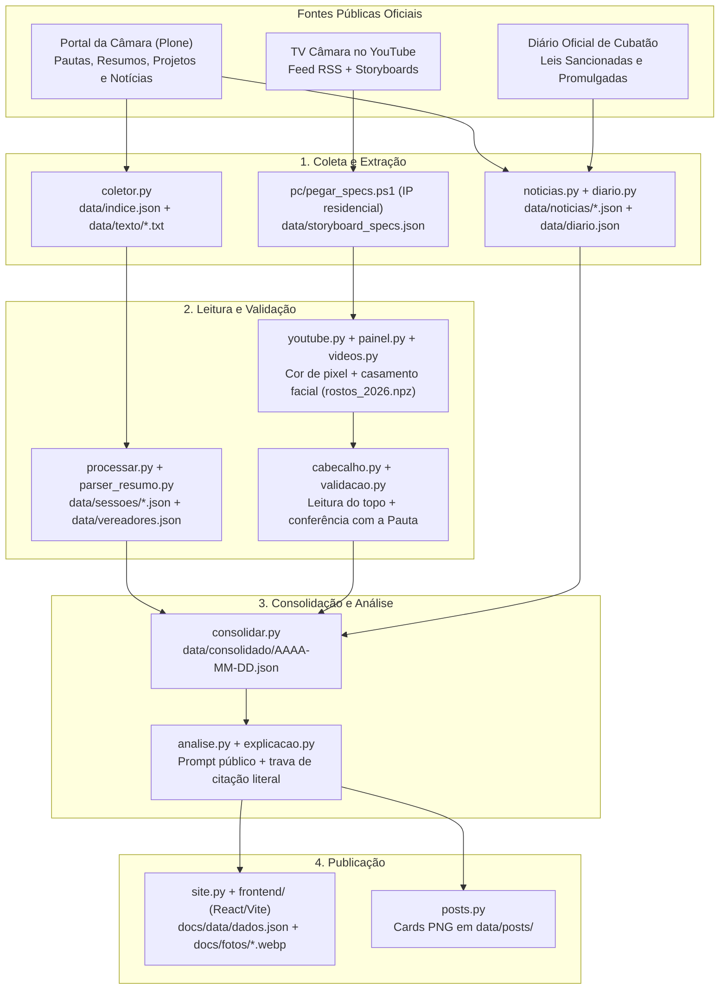

# Voto a Voto — Monitor da Câmara Municipal de Cubatão

Plataforma cívica e independente de transparência legislativa que coleta automaticamente tudo o que a **Câmara Municipal de Cubatão/SP** publica — pautas, resumos oficiais de sessão, projetos de lei, vetos, notícias, Diário Oficial do Município e transmissões da TV Câmara no YouTube — e transforma em **dados abertos auditáveis**, **análises imparciais baseadas estritamente no documento oficial** e um **portal web interativo**.

- **Portal principal (Surge):** [https://votoavoto.surge.sh](https://votoavoto.surge.sh)
- **Espelho oficial (GitHub Pages):** [https://wardernoob-dot.github.io/monitor-camara-cubatao/](https://wardernoob-dot.github.io/monitor-camara-cubatao/)

---

## Sumário

1. [Visão Geral e Status](#1-visão-geral-e-status)
2. [Arquitetura e Pipeline de Dados](#2-arquitetura-e-pipeline-de-dados)
3. [Fontes Oficiais e Cruzamento de Dados](#3-fontes-oficiais-e-cruzamento-de-dados)
4. [Regras de Interpretação Legislativa](#4-regras-de-interpretação-legislativa)
5. [Uso Responsável e Auditável de IA](#5-uso-responsável-e-auditável-de-ia)
6. [Anomalias Reais dos Documentos Tratadas pelo Código](#6-anomalias-reais-dos-documentos-tratadas-pelo-código)
7. [Engenharia de Segurança e Hardening (AppSec & CI/CD)](#7-engenharia-de-segurança-e-hardening-appsec--cicd)
8. [Estrutura do Repositório](#8-estrutura-do-repositório)
9. [Como Rodar Localmente](#9-como-rodar-localmente)
10. [Automação (GitHub Actions, Agente PC e Skills)](#10-automação-github-actions-agente-pc-e-skills)
11. [Princípios Inegociáveis do Projeto](#11-princípios-inegociáveis-do-projeto)

---

## 1. Visão Geral e Status

| Módulo / Etapa | Estado Atual | Como Funciona |
|---|---|---|
| **Coletor Documental** (`camara/coletor.py`) | Em produção (a cada 4h) | Varre pautas, resumos e projetos no portal Plone da Câmara, calcula `SHA-256` e extrai o texto integral. |
| **Leitura do Painel Eletrônico** (`camara/painel.py`, `camara/videos.py`) | Em produção (desde set/2026) | Lê o voto nominal de cada vereador (incluindo quem estava presente e não votou) direto das folhas de storyboard da transmissão no YouTube por cor de pixel e geometria fixa (**sem IA**). |
| **Identificação e Validação de Pauta** (`camara/cabecalho.py`, `camara/validacao.py`) | Em produção | Lê o cabeçalho do painel via OCR/visão e **confere obrigatoriamente contra a pauta oficial do dia**. |
| **Notícias e Diário Oficial** (`camara/noticias.py`, `camara/diario.py`) | Em produção | Raspa notícias das sessões no portal da Câmara e consulta o Diário Oficial do Município (últimos 45 dias) para rastrear leis sancionadas/promulgadas. |
| **Consolidação Multi-Fonte** (`camara/consolidar.py`) | Em produção | Cruza **Painel × Resumo Oficial × Pauta × Notícia × Diário Oficial** por sessão em `data/consolidado/<data>.json`, exibindo divergências lado a lado. |
| **Análise Imparcial de Projetos** (`camara/analise.py`, `camara/explicacao.py`) | Em produção | Gera a seção *"Entenda o projeto"* usando apenas o texto oficial (com OCR automático para PDFs escaneados), prompt público e trava anti-alucinação por citação literal. |
| **Portal Web (React + TypeScript)** (`frontend/` → `docs/`) | Em produção | SPA estática publicada automaticamente no Surge e no GitHub Pages com páginas de Sessões, Projetos, Vereadores (incluindo suplentes), Busca e Metodologia. |
| **Gerador de Carrosséis** (`camara/posts.py`) | Em produção | Gera cards PNG prontos para publicação no Instagram (`data/posts/`). |
| **Hardening de Segurança (AppSec & CI/CD)** | Auditado e ativo | Proteção contra SSRF, XML Bomb, Path Traversal, ReDoS, Deserialization RCE, XSS/CSP, vazamento de credenciais e Supply Chain no GitHub Actions. |

---

## 2. Arquitetura e Pipeline de Dados

Todo o processamento é orquestrado por um pipeline único (`python -m camara tudo`), executado nesta ordem:



### Como funciona a leitura do Painel Eletrônico (sem baixar o vídeo)
1. **Desacoplamento de IP (`pc/`):** Como o YouTube bloqueia IPs de data center (GitHub Actions) ao requisitar a página do vídeo, um script PowerShell leve rodando em máquina residencial (`pc/pegar_specs.ps1`) consulta o feed RSS do canal da TV Câmara, extrai apenas a string `spec` do storyboard das sessões novas e atualiza `data/storyboard_specs.json` via API do GitHub.
2. **Download de Storyboards (`camara/youtube.py`):** O runner baixa apenas as folhas de miniaturas JPEG estáticas da barra de progresso (`https://i.ytimg.com/sb/...`), consumindo poucos megabytes por sessão inteira.
3. **Visão Computacional Determinística (`camara/painel.py`):**
   - Detecta quadros em que o painel eletrônico está aberto na transmissão.
   - Identifica cada vereador comparando o recorte do rosto na grade contra a matriz de referência `data/rostos_2026.npz` (similaridade de cosseno).
   - Lê o voto **exclusivamente pela cor dos pixels da moldura** de cada vereador:
     - **Moldura Verde:** voto `favor` (Sim)
     - **Moldura Vermelha:** voto `contra` (Não)
     - **Moldura Branca:** `presente_sem_voto` (estava no plenário, mas não registrou voto)
     - **Foto Apagada/Escura:** `ausente`
   - Agrupa quadros consecutivos da mesma votação, pega o estado estabilizado final antes do fechamento do painel e gera o link exato para o segundo da transmissão (`https://www.youtube.com/watch?v=<id>&t=<seg>s`).

---

## 3. Fontes Oficiais e Cruzamento de Dados

| Fonte | Endereço | Papel no Sistema |
|---|---|---|
| **Painel da Transmissão (TV Câmara)** | Canal oficial no YouTube (`UCSZ2lKO87tFkPxvHuvk5C7A`) | Fonte primária dos votos individuais desde **setembro de 2026**, com link para o segundo exato do vídeo e distinção entre ausente e presente que não votou. |
| **Pauta das Sessões** | `cubatao.sp.leg.br/processo-legislativo/pauta-das-sessoes-1` | Publicada na véspera. Fornece ementa, autoria e serve de **oráculo de validação** para os números de projeto lidos no painel. |
| **Resumo das Sessões** | `cubatao.sp.leg.br/processo-legislativo/resumo-das-sessoes` | PDF oficial publicado com ~2 semanas de atraso. Fonte primária de **fevereiro a agosto de 2026** e fonte de confronto com o painel a partir de setembro. |
| **Projetos de Lei e Vetos** | `cubatao.sp.leg.br/processo-legislativo/projetos-de-lei` | PDFs com o texto integral dos projetos, justificativas de autoria e razões de veto. |
| **Notícias da Câmara** | `cubatao.sp.leg.br/noticias` | Usadas como fonte complementar de checagem de placares e contexto da sessão. |
| **Diário Oficial Eletrônico** | `diariooficial.cubatao.sp.gov.br` | Consultado para identificar quando um projeto aprovado é sancionado/promulgado e qual número de Lei Municipal recebeu. |
| **SAPL** | `sapl.cubatao.sp.leg.br` | **Não utilizado para votos.** Contém apenas indicações, requerimentos, moções e ofícios; não publica projetos de lei nem votações nominais. |

### Quando as fontes divergem
O resumo oficial da Câmara frequentemente lista como "favoráveis" todos os vereadores presentes na sessão quando uma matéria é aprovada sem votos contrários — incluindo vereadores que no painel eletrônico da transmissão aparecem com moldura branca (*presente, não votou*). Também há casos registrados em que o painel mostra voto contrário e o resumo oficial registra como favorável. **O sistema nunca esconde nem escolhe um lado: o consolidado e o site exibem as duas versões lado a lado na página da matéria.**

---

## 4. Regras de Interpretação Legislativa

Qualquer alteração em `parser_resumo.py`, `consolidar.py`, `site.py` ou `posts.py` respeita estas regras:

1. **Ausência na lista do resumo não é voto contrário:** O resumo oficial só lista quem votou. Vereador presente na chamada da sessão que não consta na lista de uma votação fica como `"não consta"` (pode presidir a mesa, estar fora do plenário no momento ou não ter votado).
2. **Votos contrários no resumo:** Na maioria das votações aprovadas, o resumo só lista nominalmente os votos a favor; votos contrários só aparecem explícitos em votação dividida, veto ou parecer.
3. **Inversão de sentido em Parecer Contrário:** Quando a Câmara vota um *"Parecer contrário da Comissão de Justiça e Redação"*, votar **SIM** (a favor do parecer) significa votar **CONTRA o projeto** (arquivamento); votar **NÃO** (rejeitar o parecer) permite que o projeto continue tramitando.
4. **Votação de Veto do Prefeito:**
   - *"Manutenção do Veto"* (`favor` ao veto) = manter o veto e barrar o projeto/trecho vetado.
   - *"Rejeição do Veto"* (`contra` o veto) = derrubar o veto do Executivo para promulgar a lei.
5. **Parecer do TCE sobre Contas:** *"Rejeição do Parecer"* significa derrubar o parecer do Tribunal de Contas.
6. **Etapas sem votação nominal:** Etapas registradas apenas como despacho ou leitura sem votação nominal e sem placar real exportam `sim = None` e `nao = None` (nunca um falso placar `0 a 0`).

Cada item estruturado carrega os campos `objeto_votado` (`materia`, `veto` ou `parecer_tc`), `sentido` (`direto`, `inverso` ou `emenda`) e `rotulos` explícitos para a interface.

---

## 5. Uso Responsável e Auditável de IA

A inteligência artificial **nunca é usada para decidir ou ler como um vereador votou**. Ela entra apenas em três pontos auxiliares, sempre com verificação determinística:

1. **Leitura do cabeçalho do painel (`camara/cabecalho.py`):** Lê a faixa superior da imagem do painel para extrair o tipo/número da matéria e a etapa em votação. O resultado passa por `camara/validacao.py`, que cruza o número lido com a pauta oficial daquela sessão.
2. **Transcrição de PDFs escaneados (`camara/analise.py:transcrever_pdf`):** Quando o PDF do projeto publicado pela Câmara é apenas imagem escaneada sem camada de texto, o documento é transcrito literalmente via OCR (`data/texto/<sha256>.ocr.txt`) antes de qualquer análise.
3. **Seção *"Entenda o projeto"* (`camara/analise.py`) e explicações curtas (`camara/explicacao.py`):**
   - O modelo (Claude via `ANTHROPIC_API_KEY` ou Gemini via `GEMINI_API_KEY`) recebe **somente o texto oficial do projeto**, **sem nomes de vereadores, sem partidos e sem o resultado da votação**.
   - **Prompt 100% público:** disponível em [`prompts/analise.md`](prompts/analise.md).
   - **Trava Anti-Alucinação (`conferir()`):** Cada ponto de atenção gerado pelo modelo é obrigado a fornecer um trecho literal do documento (`trecho`). O código normaliza o texto e verifica se o trecho tem no mínimo **12 caracteres alfanuméricos** e **existe literalmente no texto oficial do projeto**. Se não existir, o ponto é descartado automaticamente e registrado em `pontos_descartados`.
   - **Cache auditável:** Cada análise grava o modelo exato utilizado, o hash `SHA-256` do texto do documento e o hash da versão do prompt (`versao_prompt`).

---

## 6. Anomalias Reais dos Documentos Tratadas pelo Código

Os PDFs e páginas publicados pela Câmara possuem peculiaridades reais que os módulos `camara/textclean.py`, `camara/nomes.py` e `camara/parser_resumo.py` corrigem automaticamente:

- **"Negrito falso" em 3 variantes nos PDFs:** letras duplicadas (`RREESSUUMMOO`), palavras coladas duplicadas (`RESUMORESUMO DADA`) e linhas/frases inteiras duplicadas pelo gerador de PDF.
- **Homógrafos cirílicos misturados ao alfabeto latino:** ex.: `CENTО` escrito com a letra cirílica `О` (`U+041E`) no meio de palavras em português.
- **Variações de grafia e erros de digitação nos nomes de vereadores:** ex.: `Barbosa` / `Barboza`, `Olivpeira`, apelidos regimentais vs. nomes civis — todos normalizados de forma canônica em `camara/nomes.py`.
- **Divergência entre título no site e conteúdo do PDF:** ex.: a 12ª Sessão Ordinária de 2026 foi publicada na listagem HTML com data `23/04`, enquanto o documento oficial interno é de `22/04`. O sistema preserva a data real do documento e registra o aviso no relatório de processamento.
- **PDFs publicados sem camada de texto (imagem pura):** detectados automaticamente pela razão de caracteres por página (`precisa_ocr: true`) e encaminhados ao pipeline de OCR.

---

## 7. Engenharia de Segurança e Hardening (AppSec & CI/CD)

O projeto passa por auditoria contínua de segurança cobrindo coleta externa, processamento de arquivos binários, execução em CI/CD, agente local Windows e frontend estático:

### 7.1. Prevenção de SSRF (Direto e via Redirecionamento HTTP `3xx`)
- Todas as requisições externas em `coletor.py`, `noticias.py`, `analise.py`, `youtube.py` e `sonda_storyboard.py` validam estritamente o esquema (`https`/`http`) e o hostname contra allowlists explícitas (`www.cubatao.sp.leg.br`, `*.youtube.com`, `*.ytimg.com`).
- Hooks de resposta HTTP (`_bloquear_redirect_externo` e `_bloquear_redirect_yt`) inspecionam **cada salto de redirecionamento (`301`, `302`, `307`, `308`)** antes de segui-lo, impedindo redirecionamento aberto para IPs internos ou serviços de metadados de nuvem (`169.254.169.254`).
- Links extraídos de feeds RSS (`_url_noticia_segura`) e URLs de folhas de storyboard (`_validar_base_storyboard`) passam por validação de domínio antes de qualquer download.

### 7.2. Proteção contra XXE, XML Bomb (*Billion Laughs*) e DoS de Memória/Disco
- Antes de qualquer parse XML (`ET.fromstring` no Python ou cast `[xml]` no PowerShell), o payload bruto é inspecionado e rejeitado imediatamente caso contenha declarações `<!DOCTYPE` ou `<!ENTITY`.
- Limites rígidos de consumo de recursos em todos os coletores e parsers:
  - `MAX_PDF_BYTES = 25 MB` (verificado via `Content-Length` e tamanho real do buffer) e `MAX_PAGINAS_PDF = 250` páginas por PDF.
  - `MAX_XML_BYTES = 2 MB` para feeds RSS/Atom e `MAX_HTML_BYTES = 5 MB` para páginas de notícias.
  - `MAX_FOLHAS = 400` folhas por storyboard, `MAX_FOLHA_BYTES = 5 MB` por folha JPEG e `MAX_FOLHA_DIM = 4096 px` antes de decodificação de matriz de imagem (anti-*Decompression Bomb*).

### 7.3. Integridade Criptográfica e Deserialização Segura (`rostos_2026.npz`)
- `Rostos.carregar()` em `camara/painel.py` exige `allow_pickle=False` explícito (eliminando vetor de *Remote Code Execution* via módulo `pickle`).
- O arquivo `data/rostos_2026.npz` tem seu hash `SHA-256` verificado criptograficamente antes da leitura (`SHA256_ROSTOS_2026`), além de validação estrita de `dtype` (apenas strings Unicode/bytes e floats primitivos) e dimensões das matrizes.
- Os vetores faciais em `data/rostos_2026.npz` e os scripts locais `pc/` ficam apenas no repositório de processamento e **não são copiados para o diretório público do site (`docs/`)**.

### 7.4. Confinamento de Caminho (*Path Traversal*) e Sanitização de Identificadores
- Todas as operações de leitura, escrita e remoção de arquivos baseadas em metadados (`sha256`, `video_id`, `slug` de notícia, caminhos de miniatura e chaves de matéria) aplicam validação por expressão regular (`^[0-9a-f]{64}$`, `^[A-Za-z0-9_-]{11}$`, `^[a-z0-9-]+$`) **e** confinamento canônico de diretório com `Path.resolve().is_relative_to(...)`.

### 7.5. Mitigação de ReDoS (*Regular Expression Denial of Service*)
- Expressões regulares aplicadas sobre textos externos (`RE_VOTO_1` em `noticias.py`, `RE_OBSTRUCAO` em `parser_resumo.py`) utilizam quantificadores limitados (`{1,600}`, `{1,120}`), e o desdobrador de "negrito falso" (`_undouble_tok` em `textclean.py`) limita o tamanho do token antes de avaliar backreferences.

### 7.6. Segurança de Credenciais e Hardening do Agente Windows (`pc/`)
- **API Keys fora de URLs:** `GEMINI_API_KEY` é enviada exclusivamente via header HTTP `x-goog-api-key` (nunca via query string `?key=`), evitando exposição em logs de exceção, proxies ou rastreamento de rede.
- **Proteção DPAPI + ACL + Limpeza de RAM no PowerShell:**
  - `pc/instalar.ps1` armazena o PAT do GitHub cifrado com DPAPI do Windows (`token.sec`), restringe a ACL do arquivo exclusivamente ao usuário atual via `icacls` (`/inheritance:r`) e limpa a área de transferência (`Set-Clipboard -Value $null`).
  - `pc/pegar_specs.ps1` decifra o `SecureString` em bloco `try / finally` garantindo a zeragem imediata do ponteiro `BSTR` em memória nativa (`[Runtime.InteropServices.Marshal]::ZeroFreeBSTR($bstr)`), valida o prefixo `^https://i\.ytimg\.com/sb/` do storyboard e remove caracteres de controle (`[\x00-\x1F\x7F]`) antes de gravar em `log.txt`.
- `.gitignore` bloqueia o commit acidental de `.env`, `.env.*`, `pc/token.sec`, `pc/*.sec`, `pc/log.txt` e `docs/CNAME`.

### 7.7. Hardening do Frontend e Prevenção de XSS
- **Sanitização de URLs (`site.py:url_segura`):** Qualquer URL exportada para `docs/data/dados.json` ou `docs/data/analises/*.json` é validada para aceitar apenas esquemas `https://` e `http://`, bloqueando `javascript:`, `data:` e `vbscript:`.
- **Renderização Segura e CSP:** O frontend React renderiza textos como nós de texto puro (sem uso de `dangerouslySetInnerHTML`), valida slugs antes de buscar JSONs de análise (`useAnalise`), aplica `rel="noopener noreferrer"` em links externos e define `Content-Security-Policy` (CSP) e `Referrer-Policy` em `frontend/index.html` e `docs/index.html`.

### 7.8. Segurança de CI/CD, Supply Chain e Guardrails de Agentes (`.github/workflows/`)
- **Pinagem Imutável por Commit SHA:** Todas as Actions de terceiros (`actions/checkout`, `actions/setup-python`, `actions/setup-node`, `anthropics/claude-code-action`) são referenciadas pelo hash SHA completo de 40 caracteres, nunca por tags mutáveis.
- **Privilégio Mínimo:** Todos os workflows declaram `permissions: contents: read` no topo, concedendo `contents: write` apenas no job específico que realiza commit.
- **Hardening de Pacotes:** Instalações `npm` rodam com `--ignore-scripts` (bloqueando execução de scripts `postinstall` maliciosos), `surge` é fixado em versão exata (`surge@0.24.1`) e `pip` prioriza pacotes binários (`--only-binary=:all:`).
- **Controle de Acesso e Anti-Prompt Injection nos Workflows do Claude:** O workflow interativo (`claude.yml`) exige `github.actor == 'wardernoob-dot'` e restringe ferramentas via `--allowedTools`, enquanto a rotina de diagnóstico (`claude-rotinas.yml`) inclui guardrails explícitos contra *Indirect Prompt Injection* oriundo de títulos/textos externos nos logs.

---

## 8. Estrutura do Repositório

```text
monitor-camara-cubatao/
├── camara/                  # Pacote principal Python (pipeline de coleta, leitura, IA e exportação)
│   ├── __main__.py          # CLI: `python -m camara [coletar|processar|tudo]`
│   ├── coletor.py           # Coleta educada de PDFs e páginas Plone da Câmara
│   ├── textclean.py         # Limpeza de "negrito falso", homógrafos cirílicos e normalização
│   ├── nomes.py             # Catálogo e normalização canônica dos vereadores e suplentes
│   ├── parser_resumo.py     # Parser estruturado dos Resumos das Sessões
│   ├── pauta.py             # Parser das Pautas das Sessões
│   ├── processar.py         # Orquestra resumos + pautas -> data/sessoes/ e data/vereadores.json
│   ├── youtube.py           # Cliente seguro do feed RSS e folhas de storyboard do YouTube
│   ├── painel.py            # Visão computacional determinística do painel eletrônico
│   ├── cabecalho.py         # Leitura do cabeçalho do painel via Gemini Vision
│   ├── validacao.py         # Validação cruzada das votações do painel contra a Pauta oficial
│   ├── videos.py            # Processamento das transmissões -> data/painel/<video_id>.json
│   ├── noticias.py          # Coleta e extração de notícias das sessões -> data/noticias/
│   ├── diario.py            # Consulta ao Diário Oficial Eletrônico -> data/diario.json
│   ├── consolidar.py        # Cruzamento Painel × Resumo × Pauta × Notícia × DO -> data/consolidado/
│   ├── analise.py           # Análise imparcial de projetos + OCR + filtro anti-alucinação
│   ├── explicacao.py        # Explicações curtas em linguagem simples -> data/explicacoes.json
│   ├── posts.py             # Geração de cards PNG para carrossel do Instagram -> data/posts/
│   └── site.py              # Exportador de dados e fotos para o frontend -> docs/data/ e docs/fotos/
├── frontend/                # Aplicação web em React 18 + TypeScript + Vite
│   └── src/
│       ├── paginas/         # Sessões, Projetos, Projeto, Vereadores, Vereador, Busca, ComoFunciona
│       ├── dados.tsx        # Hooks de carregamento e validação de dados
│       └── util.tsx         # Utilitários de formatação e navegação
├── docs/                    # Build estático publicado no GitHub Pages e no Surge
├── data/                    # Base de dados auditável versionada em Git (JSONs e textos extraídos)
├── fotos/                   # Fotos originais dos vereadores (convertidas para WebP em docs/fotos/)
├── prompts/
│   └── analise.md           # Prompt público usado na análise imparcial de projetos
├── pc/                      # Agente PowerShell para Windows (coleta de storyboard_specs em IP residencial)
├── scripts/                 # Scripts utilitários e sonda de storyboard
├── tests/                   # Suíte automatizada de testes (pytest — 53 testes de regressão e segurança)
└── .github/workflows/       # Pipelines de coleta a cada 4h, deploy no Surge e rotinas de auditoria
```

---

## 9. Como Rodar Localmente

### Pré-requisitos
- **Python 3.11+**
- **Node.js 20+** (para desenvolver ou recompilar o frontend em `frontend/`)

### 1. Instalar dependências e rodar a suíte de testes
```bash
pip install -r requirements.txt
python -m pytest -q
```
> Todos os **53 testes** (cobrindo parser de resumos, leitura do painel, consolidação, exportação do site e controles de segurança) devem passar antes de qualquer coleta ou deploy.

### 2. Executar o pipeline de dados
```bash
#Apenas coletar novos PDFs do site da Câmara (a partir de 2026)
python -m camara coletar --desde 2026

#Apenas reprocessar os documentos que já estão em data/ e atualizar docs/data/
python -m camara processar

#Pipeline completo: coleta + processa + painel + notícias + DO + análises + posts + site
python -m camara tudo --desde 2026
```

**Variáveis de ambiente opcionais (para etapas de OCR e análise):**
- `GEMINI_API_KEY`: habilita leitura de cabeçalho de novas transmissões, OCR de PDFs escaneados, explicações curtas e análise de projetos no plano gratuito do Gemini.
- `ANTHROPIC_API_KEY`: se definida, assume prioridade na geração das análises de projetos (`camara/analise.py`).
- `MODELO_CLAUDE` / `MODELO_GEMINI`: permitem sobrescrever o modelo padrão.
*(Sem chaves configuradas, o pipeline executa normalmente toda a coleta, leitura de votos, consolidação e geração do site, pulando apenas chamadas novas de LLM).*

### 3. Rodar ou compilar o Frontend (React/Vite)
```bash
cd frontend
npm install --ignore-scripts
npm run dev      # servidor local de desenvolvimento
npm run build    # compila para ../docs/ (atualiza o bundle estático do site)
```

---

## 10. Automação (GitHub Actions, Agente PC e Skills)

1. **Coleta Automática (`.github/workflows/coleta.yml`):**
   - Roda a cada **4 horas** (no minuto `17`) ou via disparo manual/remoto (`workflow_dispatch`).
   - Executa `pytest -q` (testes quebrados abortam a rodada), roda `python -m camara tudo`, commita eventuais novidades em `data/` e `docs/data/` como `monitor-camara-bot` e publica `docs/` em [https://votoavoto.surge.sh](https://votoavoto.surge.sh).
2. **Publicação Contínua (`.github/workflows/publicar-surge.yml`):**
   - Sempre que `docs/`, `fotos/` ou `camara/site.py` mudam na branch `main`, regenera `docs/data/` e `docs/fotos/` (se necessário), commita no repositório para manter o GitHub Pages sincronizado e republica no Surge.
   - **Atenção:** Nunca commite o arquivo `docs/CNAME` (já bloqueado no `.gitignore`), pois isso quebraria o espelho no GitHub Pages.
3. **Agente Residencial no Windows (`pc/instalar.ps1` e `pc/pegar_specs.ps1`):**
   - Configura uma Tarefa Agendada no Windows que verifica o feed RSS do canal da TV Câmara no YouTube a partir de IP residencial, atualiza `data/storyboard_specs.json` quando surge sessão nova e dispara automaticamente o workflow `coleta.yml` no GitHub Actions.
4. **Roteiros de Auditoria (`.claude/skills/`):**
   - `conferir-coleta-do-dia`: audita commits automáticos de coleta.
   - `revisar-regra-de-voto`: confere mudanças em parsers e consolidação contra as regras regimentais.
   - `validar-painel`: audita leituras do painel eletrônico da transmissão.
   - `conferir-fonte`: garante que todo voto exibido tenha lastro em documento ou vídeo oficial.
   - `clareza-pro-leitor`: revisa textos e telas voltados ao morador de Cubatão.

---

## 11. Princípios Inegociáveis do Projeto

1. **Fonte oficial sempre à vista:** Todo voto e todo projeto exibem o link direto para o PDF oficial da Câmara ou para o segundo exato do vídeo da sessão no YouTube.
2. **A IA nunca é fonte de fato:** Votos são lidos por cor de pixel no painel ou extraídos do texto oficial do resumo. Análises textuais usam apenas o documento oficial, com prompt aberto e verificação automática de citações literais.
3. **Sem juízo de valor nem ranking de vereador:** O projeto não atribui nota, selo de "bom/ruim" nem ranking a parlamentares. O papel da ferramenta é tornar o dado público acessível, legível e auditável por qualquer cidadão.
4. **Trilha de auditoria imutável:** O histórico do Git + os hashes `SHA-256` em `data/indice.json` permitem comprovar exatamente quando cada documento foi publicado pela Câmara e se sofreu alteração posterior.
